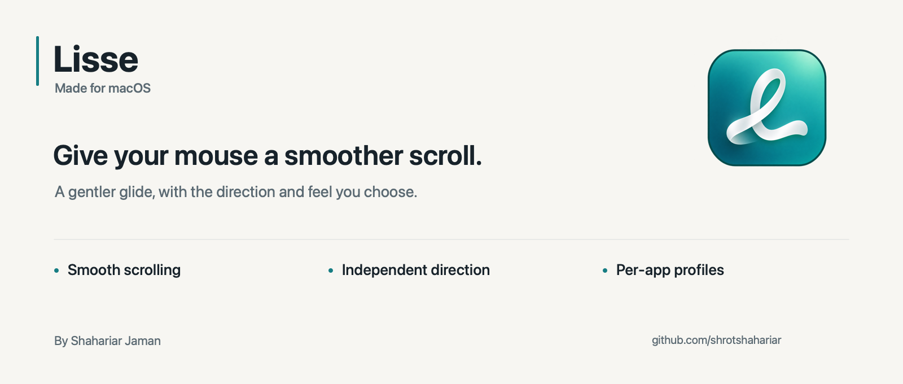

<picture>
  <source media="(prefers-color-scheme: dark)" srcset="banner-dark.png">
  
</picture>

<p align="center">
  <a href="https://github.com/shrotshahariar/Lisse/releases/download/v1.6/Lisse.zip"></a>
</p>
<p align="center"><strong>macOS 13+ · Apple silicon and Intel</strong><br>Native menu-bar utility · Accessibility access required</p>
<p align="center"><a href="https://github.com/shrotshahariar/Lisse/releases/latest">Release notes</a> · <a href="https://github.com/shrotshahariar/Lisse/issues">Report an issue</a> · <a href="#install-on-a-mac">Installation</a></p>

---

## Lisse

Make mouse-wheel scrolling glide. Tune the feel, give your mouse its own direction, and keep trackpad scrolling unchanged.

## Download

**[Download Lisse for macOS](https://github.com/shrotshahariar/Lisse/releases/download/v1.6/Lisse.zip)** · [All releases](https://github.com/shrotshahariar/Lisse/releases)

| Release | Requires | Mac support |
| --- | --- | --- |
| Lisse 1.6 | macOS 13 or later | Apple silicon and Intel |

## Install on a Mac

1. Download the ZIP, extract it, and move **Lisse.app** into **Applications**.
2. Open the app. This release is ad-hoc signed and has not been notarized by Apple.
3. If macOS blocks it, open **System Settings → Privacy & Security → Open Anyway**, then confirm that you want to open this downloaded app.

Updating? Quit the running app first, then replace the copy in Applications.

Allow **Lisse** in **System Settings → Privacy & Security → Accessibility** so it can read and rewrite mouse-wheel events. Open Settings from the menu-bar icon to choose your scrolling preferences.

## Find your glide

| Control | What it changes |
| --- | --- |
| **Precise, Balanced, Soft glide** | Start with a preset, from a tighter response to a longer, gentler glide. |
| **Step, Speed, Duration** | Tune the distance of a wheel notch, its multiplier, and how long scrolling eases out. |
| **Vertical and horizontal** | Smooth either axis or both; reverse their directions independently. |
| **Per-app profiles** | Give individual apps their own settings, or enable Lisse only for listed apps. |
| **Pause and Try for 30 seconds** | Compare the feel; the timed trial returns to paused automatically. |

## Your mouse, your settings

Mouse-wheel direction is independent of the trackpad. By default, hold **Option** to accelerate, **Shift** to scroll horizontally, or **Command** to pause smoothing. Each modifier can be changed or turned off.

Choose System, Light, or Dark appearance, adjust the accent color, and enable launch at login. If you hide the menu-bar icon, opening Lisse again brings the icon and preferences back.

[Read the full preferences guide](GUIDE.md#preferences), including trackpad simulation and app exceptions. Button remapping and Logitech-specific device features are outside Lisse’s scope.

## Permissions

Accessibility access is used to intercept and modify mouse-wheel events. Trackpad scrolling is left alone. You can pause Lisse from Settings or quit it from the menu bar.

## Build it yourself

With Apple’s Command Line Tools installed:

```sh
scripts/build-app.sh
scripts/test-scroll-delivery.sh
```

The build produces `build/Lisse.app` and `build/Lisse.zip` for Apple silicon and Intel. The regression checks do not install event taps or post events to macOS. You can also open `Lisse.xcodeproj` in Xcode and run the Lisse scheme.

See the [development and release guide](GUIDE.md#build) for SDK selection and release packaging.

## Support and updates

[Release notes](https://github.com/shrotshahariar/Lisse/releases/latest) · [Report an issue](https://github.com/shrotshahariar/Lisse/issues)

For scrolling issues, include your macOS version, mouse model, affected app, and the preset or settings in use.

Made by [Shahariar Jaman](https://github.com/shrotshahariar). Version 1.6 design process adapted from [unslop by Damir Sokolovsky](https://heydamir.design/unslop), CC BY 4.0.
